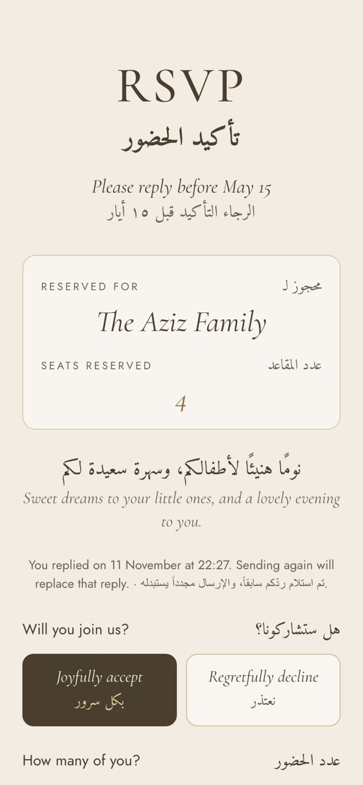
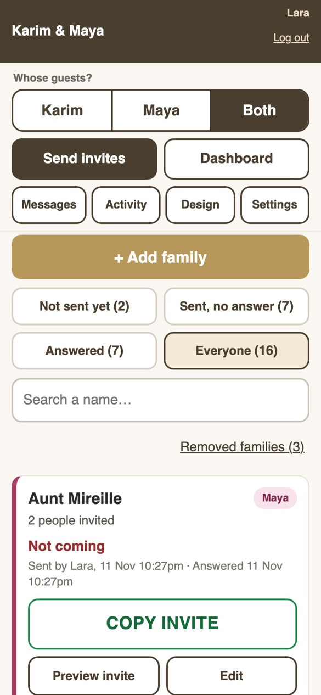
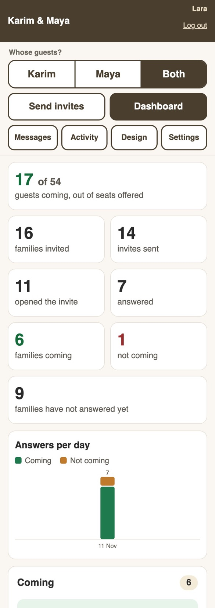
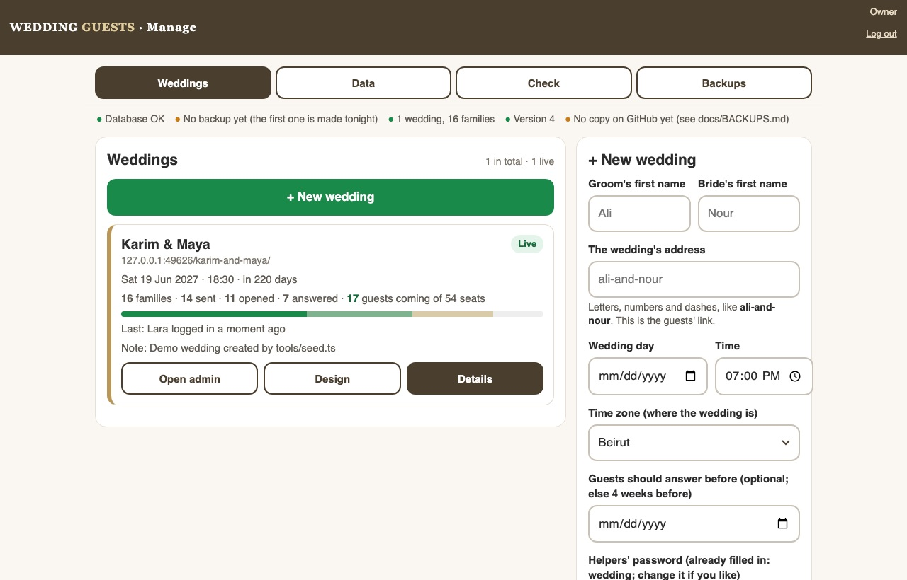
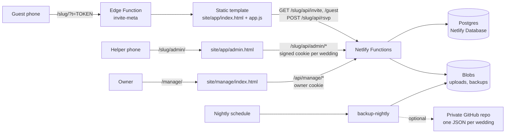
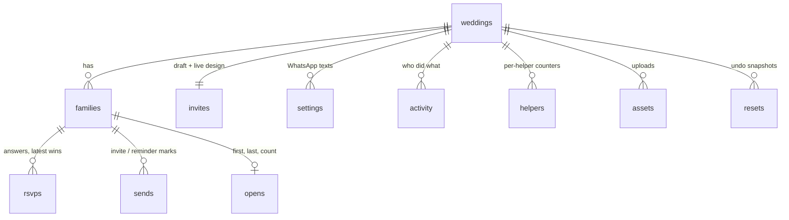

# Wedding Guest Platform

[](https://github.com/anader298/wedding-guest-platform/actions/workflows/test.yml)

Wedding invitations with the guest list behind them: one private link per family, replies and seat counts, and a helper's name on every action. Many weddings on one small site.

**Live demo:** [dandoungroup.com/testweddingsite](https://dandoungroup.com/testweddingsite/). The product's live page, with a sample invitation you can open on your phone. No install needed.

> **About this repo.** This is a public snapshot of a private application that runs real weddings and is updated continuously. The private repository holds real guest data, so its history stays private; this copy was published as one commit on 11 November 2026, and every change since is its own commit. It runs on sample data only.

**On a phone, left to right:** the invitation a family receives, the RSVP reserved for that family, the helpers' list, and the dashboard.

<p align="center">




</p>

**The owner page.** Every wedding with sent, opened, answered and coming counts.



All screenshots come from a local copy running the real functions against sample data. The couple (Karim & Maya), every family and every helper are invented.

## The problem

The invitation was a page. The problem was the list.

A Lebanese wedding runs to three hundred to six hundred guests, invited family by family, mostly over WhatsApp, by whichever relatives are willing. The groom's side and the bride's side keep separate lists. One aunt gets the invitation twice, a cousin abroad never gets it, and replies arrive as "we're coming, four of us" in a chat and never reach the sheet. Vendors sell the page. None of them lets several non-technical relatives send from their own phones and see, in one place, who sent what to whom and which families have gone quiet.

## What it does

- **A per-wedding invitation at `/<slug>/`.** An animated envelope in Arabic and English. Each family opens its own link (`/<slug>/?t=TOKEN`) and sees its own name and seat count on the card before answering.
- **Per-family links, no guest login.** A 10-character token per family. Removing a family stops its link; putting it back restores the same link with its history.
- **RSVP and guest counts.** Accept or decline, how many of the reserved seats, and the name of everyone coming. Answering again replaces the earlier answer. The dashboard shows coming / not coming / not answered, and every number opens into the list of names.
- **A per-wedding admin at `/<slug>/admin/`.** Helpers log in with their own name and the wedding's password. They add families by hand or from Excel, copy an invite (or open WhatsApp or e-mail when a number is saved), mark reminders, and see sent, opened and answered per family. The Activity tab records who did what and when. Excel goes back out with Families, Summary and Activity sheets.
- **Design upload.** A Design tab changes names, dates, venue, colours, fonts, per-page and per-line styling, and swaps the envelope, seal, photo, preview picture and music. Changes are saved as a draft and published when ready. A second mode replaces the template with uploaded Canva pages and places the live parts (seal, family name, countdown, answer form) on top.
- **A group manager at `/manage/`.** The owner creates, copies, archives and deletes weddings, sees every wedding's counts in one list, filters all families across weddings, runs a consistency check (duplicates, more guests than seats, sent and never opened), and makes or restores backups.
- **Link previews.** An Edge Function writes each wedding's names and preview picture into the page head, so a link pasted into WhatsApp previews as that couple, not the template.

Safety rules that run through the code: every destructive action asks twice; two helpers editing the same thing get a conflict, not a silent overwrite; phone numbers and e-mails never reach the public invite or its API; five wrong passwords lock that address out for fifteen minutes; a broken design falls back to the wedding's own names, never another couple's.

## How it works

Static pages, small server functions and one Postgres database. No framework and no build step for the pages. No model or external service runs at request time.



- `netlify/functions/`: one file per address group (`wedding-guest`, `wedding-rsvp`, `wedding-invite`, `wedding-asset`, `wedding-admin`, `manage`, `backup-nightly`). Shared code lives in `_lib/`: the database door (`_db.ts`), password hashing and cookies (`_auth.ts`), the design object (`_invite.ts`), exports and restores (`_data.ts`), backups (`_backup.ts`, `_github-backup.ts`).
- `site/app/`: the invitation template and the admin page, shared by every wedding. A loader at the top of `app.js` fetches the wedding's published design and fills it in. The rest of the template stays byte-identical, and a pixel test proves it.
- `site/manage/`: the owner page.
- `migrations/`: plain SQL, applied in order on cold start under an advisory lock. Locally and in tests the same SQL runs on PGlite (Postgres in Node).

### Data model



- `weddings`: slug, names, event time and time zone, status (live or archived), scrypt password hash, a session version that logs every helper out when bumped.
- `families`: token, display name, side (`a` groom, `b` bride), seats (1 to 50), optional message, phone and e-mail. Soft-deleted, so a restored family keeps its link. Names are unique per wedding, ignoring case and spaces.
- `rsvps`, `sends`, `opens`: append-only facts per family. The current state is derived, which is what makes "undo" and "reset" safe.
- `activity`: one line per action with the helper's name, read by the Activity tab every 30 seconds through an `(wedding_id, id)` index.
- `backups`, `login_attempts`, `schema_version`: operations.

The full API is in [`docs/API.md`](docs/API.md); backup retention and the GitHub copy in [`docs/BACKUPS.md`](docs/BACKUPS.md).

## Stack

- TypeScript on Netlify Functions (Node 22) and one Netlify Edge Function (Deno)
- Postgres: Netlify Database through `pg` in production, PGlite on a laptop and in tests
- Netlify Blobs for uploads and backup files
- Plain HTML, CSS and JavaScript for the three pages; SheetJS (from its CDN) for Excel in and out
- `node:test` with `tsx` for 88 server tests; Playwright for page and journey checks on WebKit (iPhone) and Chromium (Android)
- A GitHub Actions workflow that runs `npm test` on every push (`.github/workflows/test.yml`)

## Results

From the live case study:

- 3 pages the owners touch: invitation, wedding admin, owner page
- 88 automated tests passing, plus page checks on two phone engines (all 88 pass on this copy; `pages-smoke.mjs` passes 44 of 44)
- 4 helpers editing at once, from phones, at the original wedding
- 2 days from first commit to a reviewed, deployable product
- $0 monthly infrastructure today; about $12 a month once paying

Outcomes on the first wedding and on paying customers are not yet measured.

## Limits: what a copy button cannot know

- Copy records intent, not delivery. A helper can copy an invite and forget to paste it.
- One guest opening the link on three devices looks like three opens.
- A hosted page is a single point of failure in a country with four to six hours of state power a day. A static fallback page and a one-tap image of the invitation are on the build list.
- The buyer's reference price for a digital invitation is $3 to $35. The product has to be bought as the list, not the card.
- Software this size is cheap for anyone to build now. The people running it are what a family pays for.

## Run locally with sample data

Needs Node 22 or later.

```sh
npm ci
npm test                      # 88 tests, in-memory Postgres, no network
```

To click through the three pages you also need the Netlify CLI (`npm i -g netlify-cli`). It runs offline and never talks to Netlify.

```sh
node tools/qa/run-all.mjs --serve
# prints: Address http://127.0.0.1:<port>   Owner password <random>   Helpers' password of karim-and-maya: wedding
node tools/sample-guests.mjs http://127.0.0.1:<port>   # optional: 16 invented families, four helpers, sends and answers
```

This copies the repository to a temporary folder, starts `netlify dev --offline` with its own throwaway database, and seeds the demo wedding. Then open:

- `/karim-and-maya/?demo=1`: the invitation (or a family's own link, printed by the sample script)
- `/karim-and-maya/admin/`: any name, password `wedding`
- `/manage/`: the owner password it printed

Ctrl+C stops it and deletes the copy. For the browser checks, see [`tools/qa/README.md`](tools/qa/README.md).

## About

Built by Anthony Nader (Dandoun Group): first for one family's wedding, then forked into a multi-wedding product that a small family business runs on its own accounts. Case study: https://dandoungroup.com/case-studies/#wedding-planners

## Rights

Copyright Anthony Nader. All rights reserved; shown for portfolio purposes. The product is live and operated by another business, so no open-source licence is granted. The Basmala calligraphy in `site/app/index.html` is by a Wikimedia Commons contributor under CC BY-SA 4.0 (credited in the file).

## Methodology

Use: Automate. Lever: time and risk. Several relatives send invitations from their own phones, and the owner page and Excel summary show who was sent one and who replied, so no guest is missed.

| Step | Done by | Check |
|---|---|---|
| Write and test the code | AI coding agents, reviewed by a person | 88 server tests, Playwright checks |
| Import families from Excel | Code (SheetJS) | Preview before saving |
| Send an invitation | Person, from their own WhatsApp | Recorded with the helper's name |
| Open and answer | Code | Per-family token; phone and e-mail never reach the public invite (tested) |
| Edits and destructive actions | Code; a person confirms twice | A conflict instead of a silent overwrite; undo snapshots |
| Back up | Code, nightly | Netlify Blobs; restore is the owner's action |

- **Playbook or agent, and why.** Neither: plain code. Four relatives need the same behaviour every time, and no step needs a model.
- **How it was built.** AI coding agents, two days from the product's first commit to a reviewed build. Tests run on PGlite, so they exercise the production SQL migrations.
- **How it's checked.** 88 server tests passing on 18 Nov (`npm test`); Playwright on WebKit and Chromium passed 44 of 44 at publication. GitHub Actions runs `npm test` on every push.
- **Limits.** Copy records intent, not delivery; one guest on three devices counts as three opens; `site/app/admin.html` is 2,569 lines. See [Limits](#limits-what-a-copy-button-cannot-know).

How I build with AI: [github.com/anader298/how-i-build-with-ai](https://github.com/anader298/how-i-build-with-ai)
